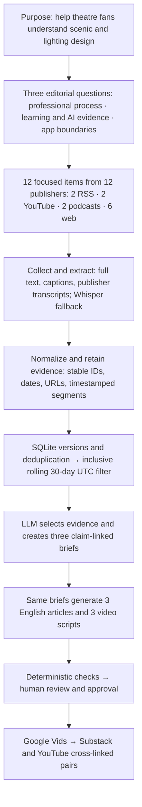

# Problem Set 4 Student Submission

Complete this document with your project details and links. Keep the course instructions in [README.md](README.md) and the required contracts in [ARCHITECTURE.md](ARCHITECTURE.md).

**Student:** To complete  
**GitHub repository:** To add after repository publication

## Topic and Audience

- **Publication name:** How a Stage Takes Shape
- **Topic:** How scenic and lighting designers translate scripts and narrative intent into stage space, visual attention, and lighting changes; what beginners can learn; and what an AI-assisted design app can and cannot reasonably do.
- **Audience and assumed knowledge:** Theatre and musical fans without professional scenic or lighting training, including potential users who would start a stage concept from text. They may know terms such as *gobo* but not the full production workflow.
- **Central question:** How do professionals turn a story into a playable scenic world and lighting sequence, and which parts can be taught or assisted by software without concealing the designer's judgment?
- **Scope and exclusions:** Creative process, beginner scaffolding, audience experience, collaboration, and AI tool boundaries. Venue electrical engineering, fixture shopping, and unrelated design news are excluded.
- **Reason for readers to return:** New interviews, productions, and research can change the examples and sharpen the app's boundary decisions in each rolling 30-day edition.

## Publication and Video Production

The three English articles and their companion videos are published publicly. Each Substack article embeds its companion YouTube video, and each YouTube description includes the matching Substack article URL. The separate technical demonstration recording is included below (5:00).

| Piece | Substack article | Video | Duration | YouTube video | Google Vids project | Exported MP4 |
| --- | --- | ---: | --- | --- | --- |
| 1 | [Article](https://jliuseeu.substack.com/p/how-a-stage-takes-shape-a-beginners) | Scenic and Lighting Design: Story, Space, and Stage Magic | 2:39 | [Watch](https://www.youtube.com/watch?v=1I4OeKRqI9c) | [Edit](https://docs.google.com/videos/d/1xruAI5j3bSjfLisiHxXIsTrWtQzG3bk42hZ7X7v7tjo/edit) | [Drive export](https://drive.google.com/file/d/10YpDUy60u3QjyTd0NGYLABsgVBq6uCRe/view) |
| 2 | [Article](https://jliuseeu.substack.com/p/how-a-stage-takes-shape-a-beginners-bd5) | How a Stage Takes Shape: The Art and AI of Stage Design | 3:00 | [Watch](https://www.youtube.com/watch?v=_-si0wmPpj0) | [Edit](https://docs.google.com/videos/d/1B6eJaFHURYr4qDBRy51Mkw8aHAGHR3CXyH1kY8b5Pho/edit) | [Drive export](https://drive.google.com/file/d/1yQsqm-JfzkLCS_Pn4AhjqRZCrrJULcgU/view) |
| 3 | [Article](https://jliuseeu.substack.com/p/how-professionals-shape-theatrical) | What a Beginner-Facing AI Stage-Design App Should Promise | 1:59 | [Watch](https://www.youtube.com/watch?v=uUYmsbfxTFU) | [Edit](https://docs.google.com/videos/d/1VP1JeYQh477KbDxctXz5AuXHbcDtq2hlgLDYkXdIsEc/edit) | [Drive export](https://drive.google.com/file/d/1luUBDxnui2f9SMa1pDwO9k0GnMHTL5rn/view) |

**Technical demonstration video (5:00):** [Open the MP4](assets/technical_demo.mp4).

<video controls width="800" preload="metadata">
  <source src="assets/technical_demo.mp4" type="video/mp4">
  Your browser does not support embedded video. Use the MP4 link above.
</video>

**Publications:** All three Substack articles and YouTube videos are public and cross-linked. The Substack archive and article pages load. Their URLs are recorded in `publication_links.json`. The Drive export links above retain their current Google account access settings; course-staff access has not been verified.

## Setup and Execution

Install Python dependencies with `python -m pip install -r requirements.txt`. Use Bash (Git Bash or WSL on Windows), FFmpeg, `whisper.cpp` with an English GGML model, and `yt-dlp`. See [collectors/MEDIA_SETUP.md](collectors/MEDIA_SETUP.md). The AI stages use the OpenAI Responses API (`OPENAI_API_KEY`, optional `OPENAI_MODEL`, default `gpt-4.1-mini`); no key is stored in this repository. `PYTHON_BIN`, `FFMPEG_BIN`, `WHISPER_BIN`, `WHISPER_MODEL`, and `WHISPER_THREADS` configure local tools. The first live run used a transient process environment variable for the model credential.

Edit `config/project.json` for topic and audience; `config/sources.json` for required RSS, YouTube, and podcast endpoints; `config/supplemental_articles.json` for clearly labeled direct-web supplements; `config/material_focus.json` for the current twelve-item topical collection focus; `config/editorial_policy.md` and the four files in `prompts/` for editorial judgment. Each run snapshots these files. A date-only source is retained with `published_date_precision: day` rather than an invented clock time.

The intended entry commands are:

```bash
bash run.sh
bash run.sh --package runs/RUN_ID
```

Replace `RUN_ID` with an actual run directory. Add any setup or stage-replay commands a reviewer needs.

## Architecture and Manual Handoffs



The [full project overview and source-to-article map](runs/20261016T013902Z-d1bac7b7/package/architecture_graph.html) is available as [HTML](runs/20261016T013902Z-d1bac7b7/package/architecture_graph.html) and [Markdown](runs/20261016T013902Z-d1bac7b7/package/architecture_graph.md).

The required 16 Bash entry points keep their specified responsibilities; Python helpers implement the internals. The OpenAI Responses API is called only by editorial selection, brief creation, and the two writing components. `data/store.sh` owns the persistent SQLite index at `data/evidence/index.sqlite3`; retained text and transcripts are in `data/assets/`, original media in ignored `data/media/`, and stage artifacts in `runs/RUN_ID/`.

After a passing `review.json`, the student inspected the arguments, sampled selection decisions, transcript passages, and drafts; corrections and approval are recorded in the run artifacts. `prepare_package.sh` assembled three articles, three video scripts, and claim source notes into `runs/RUN_ID/package/`. The three videos were produced in Google Vids, published with the Substack articles, and cross-linked in `publication_links.json`. The separate 5:00 technical demonstration recording is embedded above.

## Evidence and Runs

The current collection focus is in `config/material_focus.json`; each run saves `material_shortlist.jsonl`. It contains two written RSS items, two timestamped YouTube transcripts, two timestamped podcast transcripts, and six labeled web supplements from twelve independent publishers. The selected YouTube items are the National Theatre *Bacchae* set-design feature and the Anna Robb/Josh Selander lighting interview. Earlier ABT and WICKED candidates remain in the persistent corpus but are not in the twelve-item focus. Transcripts and text are retained under `data/assets/`; source audio is retained locally under ignored `data/media/`. Automated captions and ASR passages still need human verification. Git clones do not include ignored media and must retrieve it using source URLs and the documented tools.

| Run | Actual date | Run artifacts and logs | Elapsed time | Approximate cost |
| --- | --- | --- | --- | --- |
| First live run | 2026-10-15 UTC | `runs/20261015T024535Z-f30755cb/` — `ready_for_production`; 12 focused items from 12 publishers; 3 briefs, 3 English articles, 3 English video scripts; [review packet](runs/20261015T024535Z-f30755cb/review_packet.md) | 18m 12s for collection and generation, excluding the later English revision | Estimated model API cost $0.149546 for the original API run; actual bill unavailable |
| Second live run | 2026-10-16 UTC | `runs/20261016T013902Z-d1bac7b7/` — human-approved; 78 items extracted, 86 eligible corpus items, and 12 focused items from 12 publishers (2 feed, 2 YouTube, 2 podcast, 6 web); 12 accepted; 3 briefs, 3 English articles, and 3 English video scripts generated; automated review passed ([review.json](runs/20261016T013902Z-d1bac7b7/review.json), review ID `357436b36f3a17dae41062b15447cc52`); [production package](runs/20261016T013902Z-d1bac7b7/package/manifest.json) prepared, and three English videos produced, exported to Drive, published, and cross-linked to their articles. The separate 5:00 technical demonstration is recorded and embedded above. | About 18m, including recovery from an initial API authentication failure | Estimated model API cost $0.213406; actual bill unavailable; network and local compute cost unknown |

The earlier `runs/20261015T011252Z-562b83c1/` is a **failed collection-only run**, not a completed live run. It discovered 84 candidates and retained 72 date-eligible items, but 12 extra podcast candidates were not transcribed. The collector now records topic-filtered podcast skips explicitly. A later `runs/20261015T021825Z-43f72879/` collection-only run completed all nine collection stages with exit code 0: 78 eligible records, including the twelve-item focus from twelve publishers. Its overall summary still says `failed` because the editorial series was intentionally not run. The first full live run and policy comparison are documented in its [review packet](runs/20261015T024535Z-f30755cb/review_packet.md). The second live run completed collection, editorial selection, draft generation, passing automated review, human approval, and production of three English videos on 2026-10-16 UTC. `known_cost_usd` is unknown; model-cost figures are estimates from saved usage.

The three articles and videos are public and cross-linked. The technical demonstration recording is included above; its video file is also available at `assets/technical_demo.mp4`.

## Editorial Review

The working policy is `config/editorial_policy.md`; the actual prompts are in `prompts/` and snapshotted per run. The first live run made 80 AI selection decisions: 12 accepted, 67 rejected, and 1 deferred. Three accepted and three rejected/deferred decisions were sampled. The written-article versus transcript policy was revised, selection was rerun on the same eligible corpus, and overstrong claims were narrowed. The three English pieces now have distinct angles: professional process, beginner learning, and app boundaries. The deterministic review passed with the current review ID recorded in `review.json`. The student's approval is recorded in `approval.json`; the production package is being refreshed.

## Reflection

The collection stage has surfaced a useful distinction: recent professional interviews describe spatial and lighting design as script interpretation, rehearsal, collaboration, and audience attention, while a recent AI-lighting preprint addresses only part of that work. This is a hypothesis for later synthesis, not a reviewed publication claim. The first collection failure showed that transcribing every recent podcast episode is expensive and unnecessary for the selected scope; the current collector records explicit topic skips. The next improvement is reliable feed discovery for more stage-specific written sources, reducing dependence on curated web supplements.


