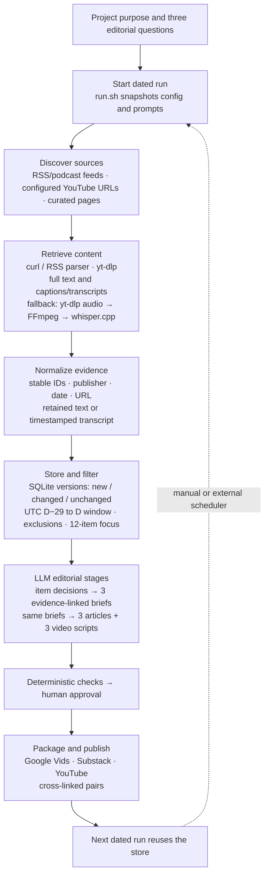

# How a Stage Takes Shape — One-Page Overview

**Purpose** — Help theatre fans without professional design training understand how story becomes scenic space and light, then use that context to judge what a beginner-facing AI stage-design app could responsibly support.

## Editorial plan

1. **Professional process:** How story, venue, performers, and lighting shape a production.
2. **Learning and AI claims:** What evidence supports, challenges, or leaves uncertain.
3. **App implications:** What a beginner tool could scaffold and what it should not promise to automate.

## Evidence for the October 16 edition

**12 focused items from 12 publishers** — 2 RSS articles, 2 YouTube videos, 2 podcast episodes, 6 curated web articles. These 12 are the edition shortlist, not all collected records. Four RSS feeds, two specific YouTube URLs, and two podcast feeds are configured.

| Type | What it contributes |
|---|---|
| RSS · 2 | Set-design reporting; an artist's production perspective. |
| YouTube · 2 | A National Theatre designer adapts *Bacchae* for school halls; a lighting designer discusses practice and teaching. |
| Podcast · 2 | Long-form conversations with scenic and lighting designers. |
| Curated web · 6 | Lighting as storytelling; dramaturgy and production worlds; audience attention; immersive theatre; early AI-lighting research. |

**Evidence cited by each saved brief** (one item may support more than one article):

| Article | RSS | YouTube | Podcast | Web | Total |
|---|---:|---:|---:|---:|---:|
| 1 · Professional design process | 1 | 2 | 2 | 3 | 8 |
| 2 · Scrutinize learning and AI claims | 1 | 1 | 2 | 4 | 8 |
| 3 · Beginner-facing app implications | 2 | 1 | 2 | 5 | 10 |

## Vertical workflow

**Two-run evidence:** Oct 15 baseline: 78 extracted; 2 new, 76 unchanged; 80 eligible. Oct 16: 78 extracted; 6 new, 23 changed, 49 unchanged; 86 eligible. The same pipeline regenerated the edition from updated evidence.

**Boundary:** Bash orchestrates fixed stages; the LLM selects, synthesizes, and drafts. Filtering, version tracking, checks, and human approval are explicit. A person or external scheduler starts each run.
